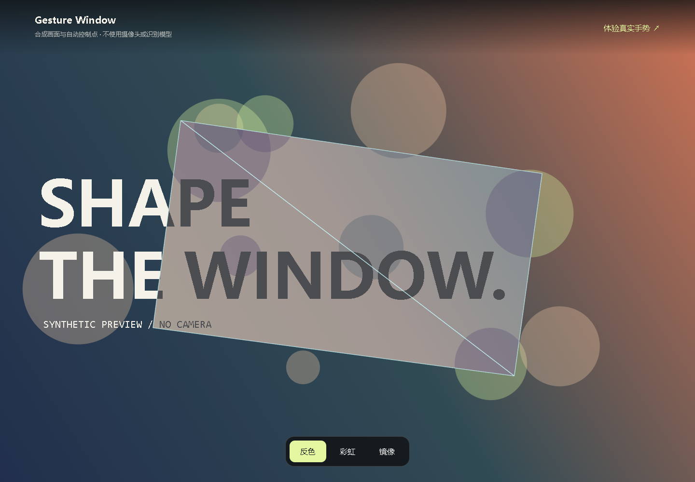

# Gesture Window

**用双手控制视觉窗口** · Real-time hand tracking meets browser graphics.

两只手的拇指和食指形成四个控制点，移动或交叉手指，改变画面窗口及叠加效果。摄像头画面和手部关键点在浏览器中处理。

## 两种体验方式

需要 Node.js 22+：

~~~bash
npm ci
npm run dev
~~~

- 打开终端给出的地址，点击“开启摄像头”，在镜头前伸出双手。
- 打开同一地址下的 /demo.html，体验合成画面：不申请摄像头、不下载手部模型，支持反色、彩虹、镜像切换。截图展示的是合成预览。

## 交互与实现

- 四指控制窗口位置与形状；交换指尖位置可形成两个重叠三角形。
- 效果区域扩大到画面约 70% 时逐渐进入全屏；移开一只手后退出。
- 支持权限拒绝、设备缺失、加载失败的提示与重试；页面离开时释放资源。

Vite + JavaScript · MediaPipe Tasks Vision · Three.js/WebGL · Vitest + Playwright。

src/gesture 处理几何和手部语义，src/camera 管理设备，src/render 负责效果，src/app 连接模块。运行组件按需加载。

## 检查与构建

~~~bash
npm test
npm run build
npm run e2e:install
npm run test:e2e
npm run preview
~~~

端到端测试使用合成画面与手部数据，不访问真实摄像头或远端模型。下载源码 ZIP 后也可安装测试浏览器；可用 PLAYWRIGHT_BROWSERS_PATH 指定已有浏览器缓存。生产预览支持 /demo.html。

## 隐私与部署

真实手势模式的模型从代码中固定版本的 Google Storage 地址下载。MediaPipe JavaScript/WASM 随仓库提供；完全离线运行真实识别时，需自行托管模型并修改 src/tracking/hand-tracker.js。

摄像头需要 HTTPS 或 localhost、用户许可及 WebGL。识别受光线、视角与遮挡影响。合成预览仅展示渲染效果，不代表真实识别性能。

[验证记录](docs/VALIDATION.md) · [MIT](LICENSE) · [第三方说明](THIRD_PARTY_NOTICES.md)
